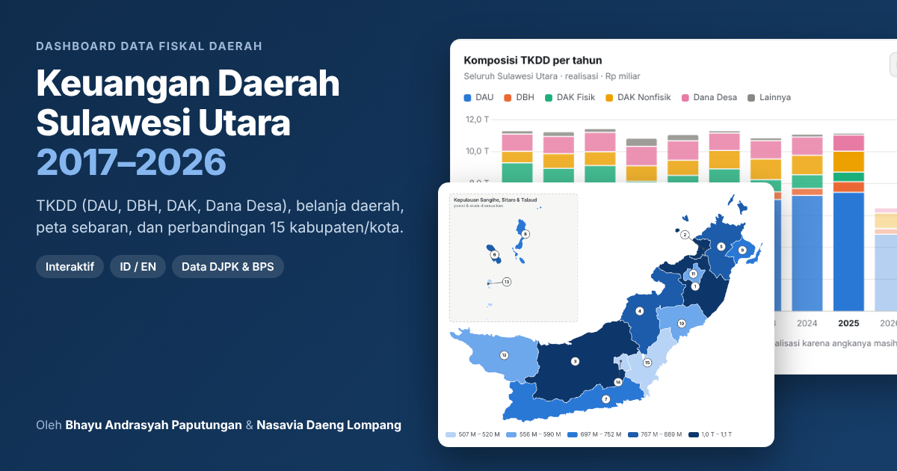

# Dashboard Keuangan Daerah Sulawesi Utara 2017–2026

**Lihat dashboard:** https://bhayupaputungan.github.io/dashboard-keuangan-sulut/

Dashboard interaktif tentang dana Transfer ke Daerah dan Dana Desa (TKDD) serta belanja daerah di 15 kabupaten/kota Provinsi Sulawesi Utara, tahun anggaran 2017–2026. Tersedia dalam bahasa Indonesia dan Inggris.

## Isi dashboard

- Ringkasan angka utama: total TKDD, TKDD per penduduk, tingkat penyerapan, dan porsi DAU, disertai poin penting yang ditulis otomatis sesuai pilihan wilayah dan tahun.
- Komposisi TKDD per tahun (DAU, DBH, DAK Fisik, DAK Nonfisik, Dana Desa, DID dan hibah), dalam versi realisasi maupun anggaran.
- Peta sebaran dan peringkat 15 kabupaten/kota.
- Belanja pegawai dan belanja modal.
- Mode bandingkan dua wilayah secara berdampingan.
- Tabel data yang bisa dicari dan diurutkan, unduhan CSV, dan tombol simpan grafik sebagai PNG.
- Kamus istilah untuk pembaca umum, mode gelap, dan tampilan yang menyesuaikan layar HP.

Tampilan tertentu bisa dibagikan lewat link, misalnya
`https://bhayupaputungan.github.io/dashboard-keuangan-sulut/#r=Kota Manado&y=2024`.

## Sumber data

| Data | Sumber |
|---|---|
| TKDD (realisasi dan anggaran) | Direktorat Jenderal Perimbangan Keuangan (DJPK), Kementerian Keuangan |
| Belanja pegawai dan belanja modal | Realisasi APBD kabupaten/kota |
| Jumlah penduduk | Badan Pusat Statistik (BPS) |
| Batas wilayah peta | BPS, OCHA ROAP, dan WFP melalui geoBoundaries (CC BY 3.0 IGO), disederhanakan |

Nilai TKDD disajikan dalam rupiah miliar dengan dua desimal, sesuai format unduhan DJPK.

## Catatan metodologi

- Total TKDD = DAU + DBH + DAK Fisik + DAK Nonfisik + Dana Desa + Dana Insentif Daerah + transfer hibah.
- Tingkat penyerapan = realisasi TKDD dibagi anggaran TKDD pada tahun yang sama.
- TKDD per penduduk = total TKDD dibagi jumlah penduduk pada tahun yang sama.
- Realisasi 2026 merupakan angka sementara saat data dihimpun.
- Belanja pegawai tersedia untuk 2017–2020 (komponen belanja tidak langsung) dan belanja modal untuk 2021–2024.
- Kota Manado, Bitung, dan Tomohon tidak menerima Dana Desa karena tidak memiliki wilayah berstatus desa.
- Angka "Seluruh Sulawesi Utara" adalah penjumlahan 15 kabupaten/kota, tidak termasuk TKDD untuk pemerintah provinsi.

## Teknologi

Satu file HTML statis dengan [Chart.js](https://www.chartjs.org/) yang disertakan langsung di dalam file, sehingga dashboard bisa dibuka tanpa server maupun koneksi ke layanan pihak ketiga. Dihosting di GitHub Pages.

## Penyusun

- **Bhayu Andrasyah Paputungan**
- **Nasavia Daeng Lompang**

Pencarian data, pemrosesan master data, dan penyusunan dashboard dikerjakan bersama.
